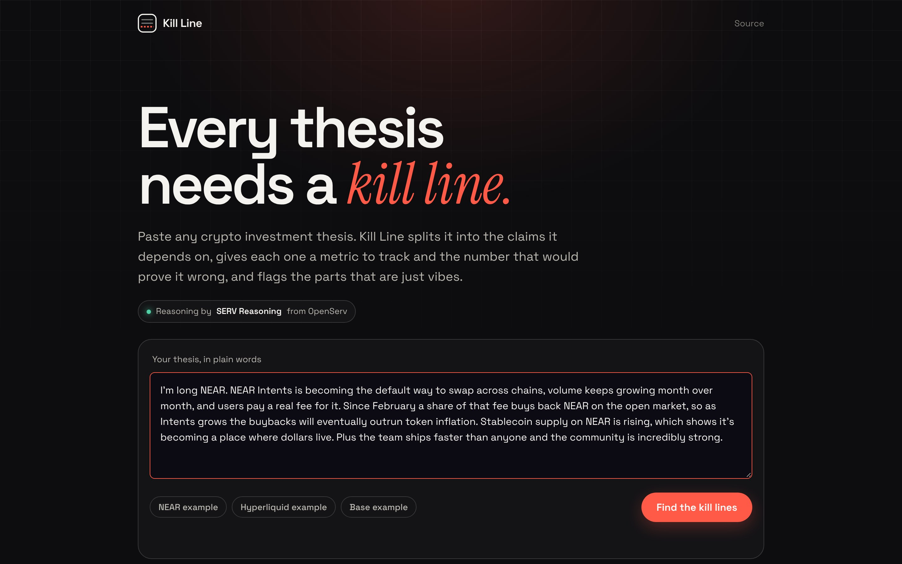
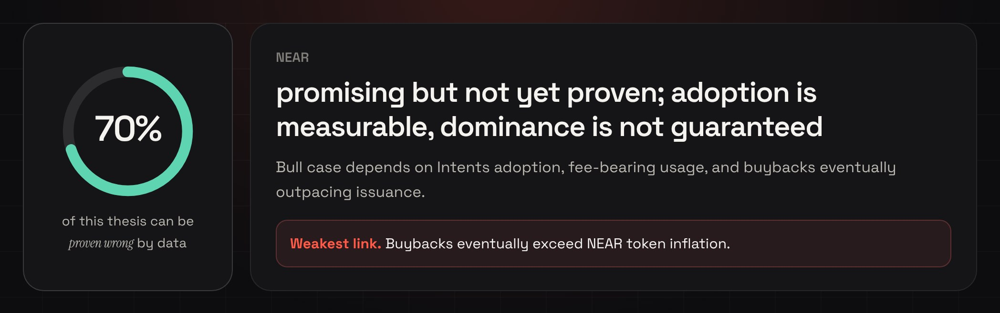
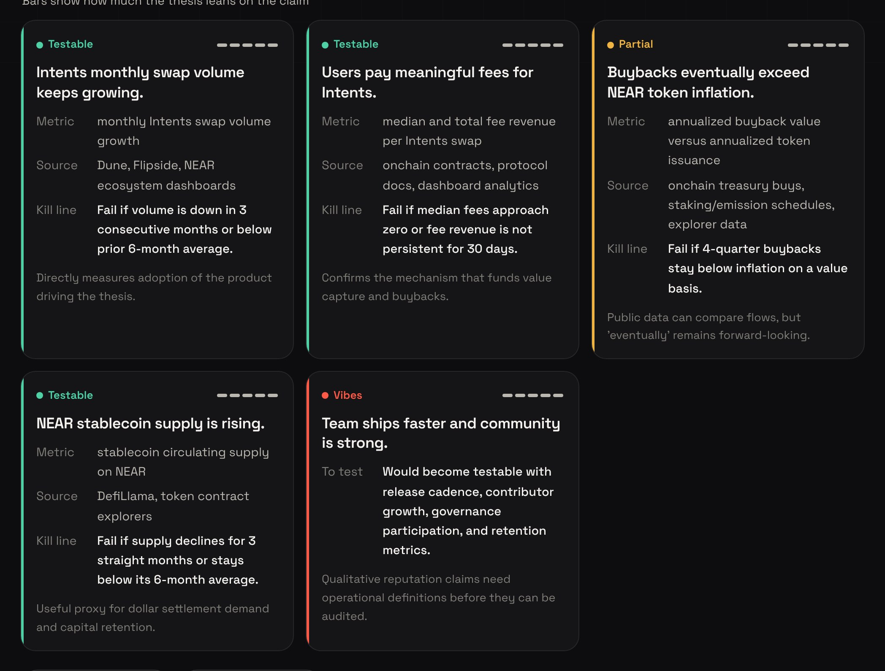
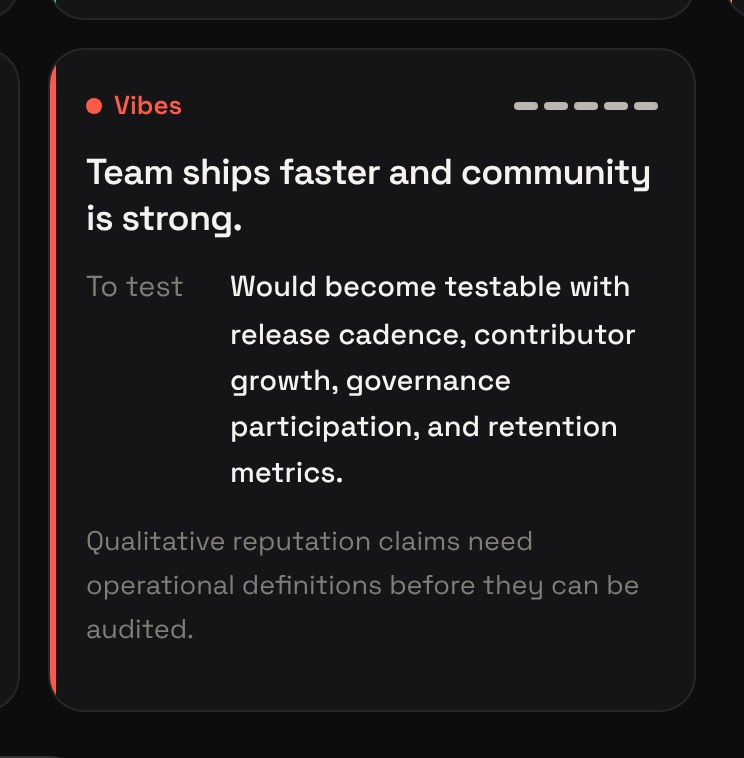
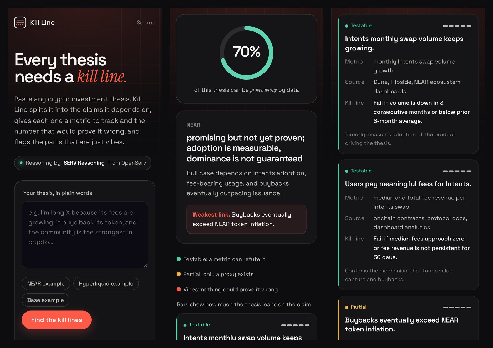
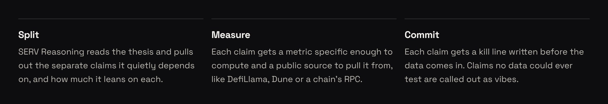

# Kill Line

**Every thesis needs a kill line.**

Paste any crypto investment thesis in plain words. Kill Line uses **SERV Reasoning** from OpenServ to:
- split the thesis into the claims it depends on
- give each claim a metric to track, a place to get the data, and the number that would prove it wrong
- flag the parts that are just vibes

Built for **SERV Hackathon 02**, Open Track. **Live:** https://kill-line-five.vercel.app



## Why

Most crypto theses are written once and never checked. They mix measurable claims ("fees are growing") with feel-good ones ("the community is the strongest in crypto"), and they almost never say in advance what would change the author's mind. So people hold positions long after the reason they bought is gone.

Kill Line makes "what would prove me wrong?" the first question, not an afterthought.

## What it looks like

These screenshots show a live SERV Reasoning result for the built-in NEAR example, recorded 16 November 2026.

**The score.** A testability score shows how much of the thesis data could disprove, weighted by how much the thesis leans on each claim. Below it are the thesis's weakest link and a one-line verdict.



**Every claim, with its kill line.** Each card shows:
- the claim, restated in one sentence
- its kind: **testable** (a public metric can refute it), **partial** (only a proxy exists) or **vibes** (nothing could ever prove it wrong)
- the metric and the data source
- the kill line: the threshold, set in advance, that would prove the claim wrong

The bars show how much the thesis depends on each claim.



**Vibes get called out.** Vibes don't get a kill line, because nothing could prove them wrong. Kill Line instead says what would have to be measured to make the claim testable.



**On a phone.**



You can copy any result as a plain-text checklist and track it yourself.

## How it works



1. The page sends the thesis to a serverless edge function: `api/kill-line.js` on Vercel, or `netlify/edge-functions/kill-line.js` on Netlify.
2. The function calls OpenServ's **SERV Reasoning** API at `https://inference-api.openserv.ai/v1/chat/completions`:
   - model `gpt-5.4-mini`, which `SERV_MODEL` can override
   - `reasoning_effort: low`
   - streamed output
3. A structured system prompt and a **strict JSON schema** pin the output shape: the asset, a summary, the verdict and the weakest link, plus every claim's kind, metric, source, kill line, weight and reasoning.
4. The response streams back to the browser as it arrives, so you can watch the reasoning land. The page then renders the score and the cards.
5. The testability score is calculated in the page from the claims themselves: testable counts 1, partial ½ and vibes 0, each weighted by its claim. This keeps the score consistent with what's on the cards.

The API key never reaches the browser. It lives in the `SERV_API_KEY` environment variable on the server.

## Run your own

1. Fork this repo and import it into **Vercel**. Leave the preset as "Other" with no build step; the page is served from `public/`.
2. Add the environment variable `SERV_API_KEY` with a key from [console.openserv.ai](https://console.openserv.ai).
3. Deploy, open the site and paste a thesis.

Add `?raw` to the URL to print SERV Reasoning's raw output under the button.

Netlify works too: the repo includes `netlify.toml` and a Netlify edge function, and uses the same environment variable.

## Layout

```
public/index.html                    the app: one file, no framework, no dependencies
public/fonts/                        Space Grotesk + Instrument Serif, self-hosted
api/kill-line.js                     SERV Reasoning call (Vercel edge function, streamed)
netlify/edge-functions/kill-line.js  the same call for Netlify
docs/                                logo and screenshots
```

Analysis, not financial advice. MIT licensed.
